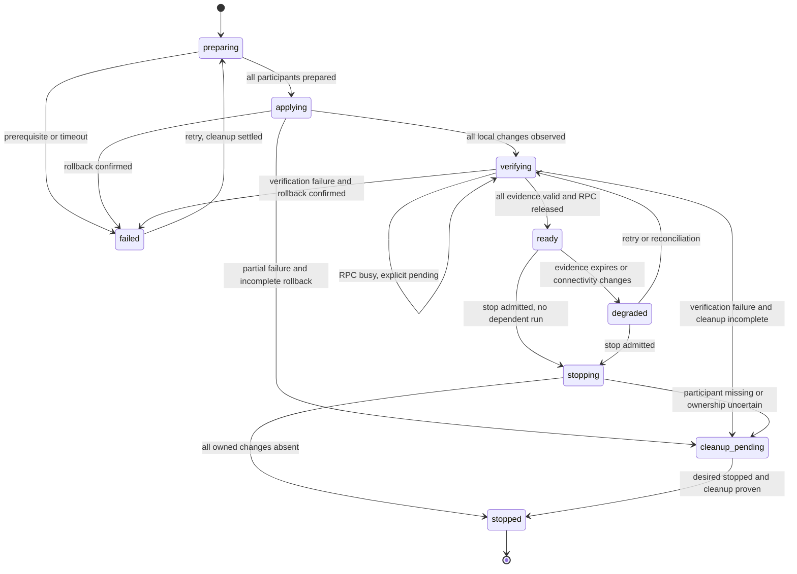

# Data Model: Managed Private Networks

All new records live in managed-network.sqlite under KLLM_HOME, independently of ClusterState. SQLite foreign keys and explicit transactions enforce relationships; one in-process mutation coordinator plus an OS/database writer lock prevents concurrent agents changing the same node. Positive counters are bounded to JSON-safe integers; timestamps are UTC for display, while live deadlines use monotonic time and never survive restart as fresh evidence.

## NodeIdentity and MasterAuthority

| Field | Meaning / validation |
|---|---|
| node_id, key_id, public_key | Existing node identity plus SHA-256 public-key fingerprint and 32-byte Ed25519 public key; identity cannot be overwritten by heartbeat. |
| private_key_path | Local restricted file only; never serialized to responses. POSIX 0600 and private directory; Windows ACL restricted to owning service account/admin. |
| paired_peer_node_id, paired_peer_key_id | Explicit local operator pairing records; no silent replacement. Master maintains paired worker keys; each worker pins one current master key. |
| cluster_binding_id | Public UUID namespace generated locally by master and explicitly pinned with its fingerprint on workers; independent of join-key values. |
| master_term, master_session_id | Persistent increasing master startup term and random session UUID; advance atomically before sockets open. Worker stores accepted high-water term. |
| accepted_channel_id | Current authenticated socket nonce transcript; replaced only by a fresh signed challenge exchange. |

Deleting a private identity invalidates management capability until explicit re-pairing. A lower term or equal term with a different session is rejected. A higher signed term supersedes old sessions after durable recording; prior socket/tasks are fenced before another host mutation. Corrupt/regressed state fails closed. No automatic master election is introduced.

## ManagedNetwork

| Field | Meaning / validation |
|---|---|
| network_id | UUID, primary key. One non-stopped network per cluster binding. |
| cluster_binding_id, master_node_id, master_key_id | Authority binding, immutable for network lifetime. |
| subnet | Canonical RFC1918 IPv4 CIDR; no network/broadcast assignment; enough usable addresses for selected participants. |
| revision | Increasing aggregate state revision; precondition for mutations. |
| desired_state | active or stopped. |
| observed_state | preparing, applying, verifying, ready, degraded, failed, stopping, cleanup_pending, stopped. |
| created_at, updated_at | UTC timestamps. |
| current_operation_id | Nullable reference to serialized operation. |

Ready requires every selected assignment ready in the current authority session with current evidence. Disconnected assignments remain persisted even if membership removes them. Stopped is reached only when every owned mutation is removed or proven absent; retained user-owned addresses are permitted.

## NodeAssignment

| Field | Meaning / validation |
|---|---|
| network_id, node_id | Composite key, foreign key to ManagedNetwork. Node must be selected and joined at preparation. |
| assignment_revision | Increasing revision for this assignment; immutable while a dependent run owns it. |
| adapter_id, os_interface, identity_fingerprint | Stable identity and current OS command identifier: Windows GUID/index, Linux MAC/ifindex/device identity, macOS service/device/MAC. Recheck for index/name reuse. |
| address, prefix_length | Usable unique address/prefix matching network subnet; unique across network. |
| ownership | user_owned, app_owned, uncertain. Exact matching pre-existing settings are user_owned. |
| link_speed_mbps, dhcp_state, permission_state | Observed preparation facts; unknown is ineligible. |
| state, error_code, message | unselected, preparing, prepared, applying, configured, verification_pending, ready, degraded, failed, cleaning, cleanup_pending, stopped; bounded sanitized diagnostic. |
| rpc_child_identity | PID plus process-start token, existing RPC bind/port, installed llama tag and protocol compatibility evidence. |
| logical_rpc_endpoint | Dedicated worker IP/port; nullable until bridge exists. |
| launch_rpc_endpoint | Master-local loopback IP/ephemeral port; excluded from worker assignment payload. |
| probe_endpoint | Dedicated source-bound signed diagnostic listener; port assigned per operation and reported. |

Do not rewrite member host, lan_host, wg_address or global rpc_bind from these records. Adapter eligibility includes proving the new connected route cannot steal the existing management route. Existing matching settings are accepted only if route/subnet usage is compatible; unrelated overlap is rejected.

## NetworkOperation and ParticipantResult

Operation fields: operation_id UUID, request_id UUID, network_id, action start/add/retry/stop/cancel, master_term/session, expected_network_revision, operation_revision, participant set, proposal digest, phase, start/deadline, terminal result and per-stage budget. Unique (cluster_binding_id, request_id); the same ID/body returns the prior result, different body returns conflict.

Participant fields: node_id, assignment_revision, expected_local_revision, stage, phase_sequence, status, signed_result_digest, prepared_snapshot_digest, ownership_journal_id, error_code and receipt time. Result receipts never substitute for local observation. Terminal results are retained for operation retries; compact historical entries only after no pending changes/run references remain.

## LocalMutationJournal

| Field | Meaning / validation |
|---|---|
| journal_id, network_id, operation_id, node_id | Identity, even after cluster leave/eviction. |
| adapter_fingerprint, exact_address_prefix | Resource being changed, not a broad adapter removal request. |
| boot_id, observation_epoch, event_high_water, observer_health | Establish authoritative address/route event continuity. Monitor starts before mutation; loss, external delete/re-add, overflow, restart or undecidable attribution invalidates ownership per contracts/platform-lifecycle.md. |
| pre_snapshot, intended_delta | Addresses, relevant routes, DNS/default-route/DHCP facts before mutation; desired exact add/remove and automatic route effects. |
| phase | intent_written, applied_observed, removal_intent, removed_observed, ownership_conflict, cleanup_pending. |
| observed_snapshot_digest, command_result | Post-state evidence and bounded command result; an exit code alone never proves ownership. |
| authority_fence, retained_error | Last authorized term/revision and cleanup reason. |

Write intent durably before OS changes. Crash between add and observed confirmation yields uncertain ownership. Remove only a continuously observed app-created exact resource with unchanged fingerprint and valid local cleanup authority. If absent, confirm removed without mutation; if externally changed or indistinguishable after an observation gap, retain ownership_conflict and require local inspection. Connected routes created by the OS are not removed separately unless independently created and proven owned. Old-operation cleanup cannot delete a resource adopted by a newer current assignment.

## VerificationEvidence

Fields: network_id, node_id, assignment_revision, master_term/session, adapter/address identity, route/interface/source results, signed bidirectional nonce proof, idle_rpc_probe_result and runtime identity, relay instance identities, observed_at, live deadline, invalidation reason.

Idle readiness requires fresh route/echo/protocol evidence tied to the same child and relay identities. Before admission, evidence must be <=10s old and must have released its RPC connection. While a managed run is active, preserve its last idle protocol result but refresh only dedicated echo, bridge stream/child and route evidence; do not renew an idle protocol timestamp without a real probe. Link/route/child/session/identity changes invalidate admission immediately. Agent startup invalidates every freshness deadline.

## RunNetworkReservation

Fields: run_id UUID, network_id, selected assignment revisions, logical endpoints, frozen loopback launch endpoints, relay instance IDs, child PID/start token, state reserved/active/releasing/released/uncertain, created_at. Per-worker AdmissionLease records contain lease_id UUID, generation, kind probe/run, assignment revisions, authority session, relay instance IDs, monotonic deadline, grant/renew/release/drain ACKs and state requested/granted/consuming/draining/released/uncertain. Expiration blocks new accepts without killing admitted streams. Persist reserved before stopping the previous master process; promote only on successful launch. Launch failure releases after actual child/stream cleanup. Crash recovery inspects the process and bridge handles before release; uncertain ownership blocks stop/new admission.

Ordered admission: durable master reservation -> signed worker probe grant/ACK -> idle probe -> release/drained ACK -> signed run grant/ACK -> launch. Persist transitions; missing ACKs stay uncertain until reconciled. Renew every 5s with 15s receive-relative lease; release is terminal and duplicate-safe. One lock covers run admission, probe exclusivity and network mutation. Changing/adding assignments that affect an active dependent network is rejected with INFERENCE_ACTIVE; no existing connection is migrated. Cluster stop may first stop the run using existing controls, then reconcile networking. Worker leave/eviction records degradation and pending cleanup, drains dependent streams as part of explicit leave, and never silently declares network removal complete.

## State Transitions

Restart enters verification_pending for intended active configuration or cleanup_pending for unresolved mutations; persisted ready is never trusted. Add uses the same preparation/application rules for new participants, retaining original addresses and restoring the prior ready set only after complete rollback if adding fails. Cancellation sets desired stopped for an initial start or reverts only the additions for add; a new operation revision fences the cancelled commands.

## Guided setup additions

AdministratorGrant is a protected native record: original account UID/SID, node_id, pinned master public key and cluster_binding_id. It contains no agent token, join secret or private key. HelperJournal stores authority fences, operation replay tombstones, grant revocation and per-network configuration scope: adapter MAC/index, exact address/prefix, signed peers/ports, original DHCP/profile/firewall configuration, mutation intent, ownership uncertainty and preparation deadline (live only).

Guided request metadata retains the submitted request digest and resolved legacy StartRequest/OperationRequest under cluster-binding/request UUID. Identical retries reuse that proposal despite inventory changes; changed bodies conflict. Assessment revisions bind all visible inventories and management hosts. Existing network adapters and subnet remain fixed during add/retry.
