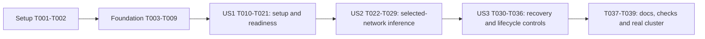

# Tasks: App-Managed Private 10GbE Network

**Input**: [spec.md](spec.md), [plan.md](plan.md), [research.md](research.md), [data-model.md](data-model.md), [contracts/](contracts/), and [quickstart.md](quickstart.md) in specs/012-app-10gbe-network.

**User constraint**: Keep the feature end to end and new tests minimal, checking only critical things.

**Organization**: Setup and shared foundations, then US1 (setup), US2 (inference), US3 (recovery), then release validation. All paths are repository-relative; proposed new files are created by the task naming them. Existing unrelated worktree changes must be preserved.

## Format and Verification Policy

Each task uses `- [ ] Tnnn [P?] [USn?] description with paths`. [P] denotes disjoint-file work after the listed prerequisite barriers, not permission to run every marked task together.

Six focused verification tasks (T010, T011, T022, T023, T024, T030) share fixtures and cover critical outcomes; do not generate a separate suite per model, parser, field or REST route. The local integration fixture uses actual HTTP/WebSocket, persistence and native socket boundaries, controlling only host configuration/hardware and inference workload. The browser journey must exercise app actions through those contracts; any substituted boundary is explicitly recorded. Real multi-node generation remains the physical end-to-end acceptance in T039.

Reuse existing platform/inference tests. Add a regression assertion for a concrete changed defect, especially the Linux DHCP detector. No coverage target, new test framework, broad fuzz campaign, exhaustive timeout matrix, reverse-order suite, benchmark framework or repeated full-suite runs are required. Preserve existing tests/skips. Use deterministic clocks for expiry and temporary state; no production bypasses to make fixtures eligible. This keeps critical contracts and safe cleanup checked while honoring the minimal-test request.

## Phase 1: Setup (Shared Infrastructure)

- [X] T001 Record the existing worktree baseline and confirm the feature scope in specs/012-app-10gbe-network/memory.md; use the available constitution and src/kllm boundaries, preserve unrelated changes, and record the still-missing workflow.md/architecture_constitution.md without claiming they were checked.
- [X] T002 Create src/kllm/managed_network/__init__.py and crates/kllm-native/src/network/mod.rs; add Python-3.10-compatible cryptography/websockets to pyproject.toml and socket2 plus required target libc/windows features to crates/kllm-native/Cargo.toml; update uv.lock and crates/kllm-native/Cargo.lock using supported tooling, keeping the committed llama-release unchanged.

## Phase 2: Foundational (Blocking Prerequisites)

- [X] T003 Implement typed identity, network, assignment, operation/result, journal, verification, run and admission-lease records in src/kllm/managed_network/models.py; enforce the verbatim T003 schema constraints below, enum transitions in data-model.md, and API bounds from contracts/control-api.md (reject unknown fields, bool-as-integer counters/ports, noncanonical/nonprivate subnets and oversized input).
- [X] T004 [P] Implement src/kllm/managed_network/store.py with SQLite foreign keys, atomic revisions/idempotency, write-ahead mutation intent, cleanup tombstones, authority high-water marks and run/lease records; store managed-network.sqlite independently of ClusterState, serialize writers across threads/processes, preserve unresolved records through membership resets, and enforce the T004 persistence constraints below.
- [X] T005 [P] Implement src/kllm/managed_network/identity.py with restricted Ed25519 key files, local fingerprint/cluster-binding pairing, exact-byte signed payload verification, duplicate-key rejection and master term/session/channel fences; enforce the T005 identity constraints below and contracts/command-socket.md; never treat shared join-key possession as master authority.
- [X] T006 [P] Define inspect/prepare/apply/observe/remove_owned contracts and fixed-command timeout/error handling in src/kllm/managed_network/platform/base.py; extract reusable inspection helpers from scripts/configure_10gbe.py without changing its CLI, and define ownership-observer/IPv4-conflict capability interfaces from contracts/platform-lifecycle.md.
- [X] T007 [P] Implement native address/route observers and Linux/macOS IPv4 ARP-conflict probing in crates/kllm-native/src/network/address_events.rs and crates/kllm-native/src/network/arp_conflict.rs; establish snapshot/event barriers before mutation, expose ordered events and explicit loss/gap states, and fail closed on unsupported permissions/observation; Windows uses authoritative native address-state/DAD after addition as specified in contracts/platform-lifecycle.md.
- [X] T008 [P] Implement source-bound master/worker bridges in crates/kllm-native/src/network/relay.rs and the independent bounded idle HELLO/DEVICE_COUNT probe in crates/kllm-native/src/network/rpc_probe.rs; enforce exact binds, peer allowlist, one admitted upstream owner, 64 KiB directional buffers/backpressure, half-close/drain and stale-handle rejection; validate TCP-only compatibility for both installed runtime ends, never raw-connect-probe RPC or retain cached probe sessions.
- [X] T009 Expose bridge/probe/observer bindings in crates/kllm-native/src/lib.rs and src/kllm/native.py, compose the native modules in crates/kllm-native/src/network/mod.rs, and rebuild through uv run python scripts/build.py --skip-ui --skip-llama --skip-wireguard --skip-toolchains; confirm import/bindings and release the GIL for blocking native work before story integration.

**Checkpoint**: Shared boundaries exist and are importable; no user-story integration starts before T009.

## Phase 3: User Story 1 - Start the private network from the master (Priority: P1)

**Goal**: Master app action configures the selected local/worker adapters, assigns unique private addresses, and reports current verified readiness without per-node configuration commands.

**Independent Test**: An idle three-agent integration run starts once, receives two authenticated worker results, verifies distinct assignments/ready state, and rejects ineligible or unauthorized setup with no host mutation. Full physical proof follows T039.

US1 includes mandatory immediate rollback and journal recovery basics; start is never shipped with cleanup deferred to US3.

### Minimal critical verification

- [X] T010 [P] [US1] Add only critical signed-authority/replay and all-node preparation-refusal checks in tests/test_managed_network_critical.py; reuse or minimally extend tests/test_configure_10gbe.py for temporary command arguments and the Linux DHCP-detector regression; assert zero OS mutations on refusal and preserved user settings, rather than one test per field/parser/route.
- [X] T011 [P] [US1] Create the shared isolated three-agent integration fixture and initial start/idempotency scenario in tests/test_managed_network_e2e.py: actual HTTP/WebSocket transport, temporary SQLite/key state and real native bridge/probe boundary, with only OS/hardware operations controlled; prove one master start drives two workers, unique assignments, duplicate delivery safety, and current sanitized readiness. Reuse this fixture in T023/T030.

### Implementation

- [X] T012 [P] [US1] Implement Windows adapter identity, DHCP/speed/permission/conflict inspection and exact temporary apply/remove in src/kllm/managed_network/platform/windows.py; use explicit ActiveStore, SkipAsSource true, no gateway, recheck DHCP before add, wait for usable native address state, and remove only the unchanged proved-owned exact object.
- [X] T013 [P] [US1] Implement macOS adapter/service identity, DHCP/speed/permission/route inspection and exact alias add/-alias removal in src/kllm/managed_network/platform/macos.py; preserve networksetup profiles/DNS/gateway and consume native ARP/observer evidence, rejecting uncertain physical/source paths.
- [X] T014 [P] [US1] Implement Linux adapter identity, all-table route/conflict inspection, temporary exact ip address add/delete and source-route validation in src/kllm/managed_network/platform/linux.py; resolve the active NetworkManager connection UUID before reading ipv4.method, support only authoritative manager evidence, reject unknown DHCP, and preserve persistent profiles.
- [X] T015 [P] [US1] Implement deterministic private-subnet proposals and distinct master/worker assignments in src/kllm/managed_network/allocation.py; check every participant, usable-address capacity and management-route conflicts; preserve existing assignments and compatible user-owned addresses, with no fixed worker-address reuse.
- [X] T016 [US1] Implement worker-initiated signed WebSocket handshake/client/server and phase/result dispatch in src/kllm/agent/services/network_channel.py; reuse the existing management base/cp_proxy, implement inspect/prepare/apply/verify/reconcile/rollback/cleanup and probe/run admission messages, durable idempotency and ACKs, frame/queue bounds, deadlines, cancellation fencing and reconnect behavior from contracts/command-socket.md.
- [X] T017 [US1] Implement master orchestration and the local worker executor in src/kllm/agent/services/managed_network.py; require every participant prepared before any apply, journal intent before each mutation and observed result afterward, enforce snapshot/authority fences, and provide a safe idle-stop path through the same executor plus immediate exact rollback and durable cleanup_pending on failure/cancellation even before US3 controls exist; retain the 15/20/20/5s stage budgets and separate 60s cleanup budget.
- [X] T018 [US1] Implement route/source checks, signed bidirectional dedicated diagnostics, bridge ownership and idle probe grants/drain in src/kllm/managed_network/verification.py; ready requires all participants verified, both runtime ends TCP-only and released probe connections; report configured/verification_pending with RPC_BUSY during existing inference; enforce the T018 evidence constraints below.
- [X] T019 [US1] Implement local token/origin/loopback-protected identity, pairing, adapter selection/inventory and master start/status/basic-safe-stop/operation routes in src/kllm/agent/handlers/managed_network.py, src/kllm/agent/schemas.py and src/kllm/agent/routes/v2.py; wire composition in src/kllm/agent/__init__.py and add managed-network-v1 capability without altering legacy /v1 contracts; return queryable 202 operations and actionable participant errors.
- [X] T020 [US1] Build local fingerprint pairing/adapter selection and master network start/status and safe-stop controls in dashboard/src/lib/components/ManagedNetwork.svelte; integrate with dashboard/src/routes/+page.svelte, dashboard/src/lib/types.ts, dashboard/src/lib/store.svelte.ts and src/kllm/agent/services/dashboard_status.py; use an optional sanitized managed_networks status field, show prerequisites/unknowns and polling cancellation, and hide mutation controls on workers except their local setup.
- [X] T021 [US1] Own store recovery, command channels, diagnostics/observers and bridge resources in src/kllm/agent/application_lifecycle.py with composition in src/kllm/agent/__init__.py; invalidate persisted readiness at startup, retain partial journals, close all owned resources in order on shutdown, and run the initial T010/T011 checks. Do not expose a network as ready until the native probe has drained.

**Checkpoint**: Complete US1, run its focused checks, and retain any unavailable physical validation as pending.

## Phase 4: User Story 2 - Use and inspect the verified private network (Priority: P2)

**Goal**: A new inference run explicitly uses the verified dedicated path with frozen endpoints; existing runs and omitted selection retain their existing connection.

**Independent Test**: Run through real bridge sockets with a controlled inference child, inspect frozen logical/launch endpoints, reject stale/unsupported selection, and show degraded status/blocked stop. T024 provides the app journey; T039 provides real-model proof.

Readiness and diagnostic infrastructure come from US1; this story adds actual run admission and selection.

### Minimal critical verification

- [X] T022 [P] [US2] Add a compact native transport check in crates/kllm-native/src/network/tests.rs covering real source-bound byte forwarding/half-close and the idle valid-probe release followed by another valid connection; include bind/allowlist refusal and lost-observation invalidation within these cases rather than exhaustive socket permutations, and wire the test module in crates/kllm-native/src/network/mod.rs.
- [X] T023 [P] [US2] Extend tests/test_managed_network_e2e.py with one managed run-admission scenario using the shared fixture: real native transport and a controlled inference child, frozen logical/loopback endpoints, no competing active-run RPC probe, blocked network stop and stale-evidence/no-fallback refusal; assert legacy omitted-selection behavior without duplicating existing inference tests.
- [X] T024 [P] [US2] Add one browser critical journey in dashboard/tests/managed-network.test.mjs using the existing Chrome/CDP helpers: local setup/master start -> ready -> explicit run selection -> blocked network stop -> stop inference -> network cleanup; use the shared agent integration fixture where practical, label any controlled platform/runtime boundary, and register the browser file in dashboard/tests/run-tests.mjs serial phase so it never competes with other Chrome tests.

### Implementation

- [X] T025 [US2] Add request-only nullable network_id and additive selected-network diagnostics in src/kllm/run_settings.py and src/kllm/agent/schemas.py; omit/null must retain LAN/WireGuard, and exclude this selector from reusable model settings via src/kllm/agent/handlers/run_settings.py.
- [X] T026 [US2] Implement durable run reservations and signed worker admission leases in src/kllm/managed_network/run_admission.py; share a serialization boundary with network mutations, persist before launch, require probe grant/ACK -> valid idle proof -> release/drained ACK -> run grant/ACK, renew every 5s with 15s receive-relative leases, and enforce the T026 reservation constraints below.
- [X] T027 [US2] Integrate explicit managed selection in src/kllm/run_planning.py, src/kllm/run_launch.py, src/kllm/agent/handlers/inference.py and src/kllm/agent/run_route.py; copy placement inventory with loopback bridge launch endpoints and retain logical endpoints separately; bypass ensure_rpc_peers_reachable only for managed runs, revalidate before replacing a prior run, return RPC_BUSY without stopping it when idle proof is unavailable, and release reservations only after failed-launch or confirmed stop/stream drain.
- [X] T028 [US2] Implement 5s dedicated/control health sampling with 2s bounded failures in src/kllm/managed_network/verification.py and src/kllm/agent/services/managed_network.py; invalidate admission immediately and publish degraded/unverified within 15s on route/link/identity/stream changes, keeping active runs on their frozen connection and using no new RPC probe while busy.
- [X] T029 [US2] Add explicit network selection and logical endpoint/run identity display in dashboard/src/routes/run/+page.svelte and dashboard/src/lib/types.ts; show stale/busy errors without fallback or automatic rerouting, keep default LAN/WireGuard behavior, and complete the T022-T024 checks with real native bindings.

**Checkpoint**: Complete US2, run its focused checks, and retain any unavailable physical validation as pending.

## Phase 5: User Story 3 - Stop, retry, and recover safely (Priority: P3)

**Goal**: Operators stop, add, retry and cancel safely and recover partial changes without removing user or uncertain configuration.

**Independent Test**: Interrupt a partial application, restart/reconnect, retry idempotently, then stop: only proven app-owned deltas disappear; missing/ambiguous nodes remain visibly pending, and dependent runs block stop.

US3 extends the safe basic rollback already required by US1; it does not retroactively provide US1 safety.

### Minimal critical verification

- [X] T030 [P] [US3] Extend tests/test_managed_network_e2e.py with a compact partial-apply/restart recovery case and an owned-versus-user/uncertain cleanup case; assert durable cleanup_pending, no stale readiness or duplicate assignment, blocked stop while reserved/active, exact no-gap removal and preservation after observer gaps/external replacement. Reuse T011 fixtures and T023 admission checks instead of new per-endpoint suites.

### Implementation

- [X] T031 [US3] Implement add/retry/cancel operation handling in src/kllm/agent/services/managed_network.py and src/kllm/agent/services/network_channel.py; preserve assignments when adding nodes, fence cancelled commands, roll back only new additions on failed add, serialize lifecycle conflicts, reject changes to active dependent assignments, and retain operation/tombstone state for delayed deliveries.
- [X] T032 [US3] Implement stop and ownership-safe distributed cleanup in src/kllm/agent/services/managed_network.py and src/kllm/managed_network/platform/base.py; reject dependent reserved/active/uncertain runs, drain bridges before exact removal, preserve user-owned settings, keep unreachable nodes pending, and reconcile within 60s of reconnect when prerequisites permit.
- [X] T033 [US3] Implement conservative restart/reconnect reconciliation in src/kllm/managed_network/store.py, src/kllm/agent/services/managed_network.py and src/kllm/agent/application_lifecycle.py; inspect journals/process/bridge identities before releasing reservations, never restore stale ready, mark observation gaps ambiguous, report reboot-disappeared settings and permit explicit retry; graceful agent restart stops dependent managed inference before bridge shutdown, abrupt loss leaves a degraded/uncertain record until the recorded child is handled safely.
- [X] T034 [US3] Add add/retry/stop/cancel and loopback-only cleanup review/resolve routes in src/kllm/agent/handlers/managed_network.py and src/kllm/agent/routes/v2.py; require current revisions/snapshot digest, forbid master commands from proving ambiguous local ownership, and support exact confirm_owned or release_ownership decisions without broad deletion.
- [X] T035 [US3] Integrate network cleanup/admission checks before identity/membership resets in src/kllm/agent/handlers/lifecycle.py, src/kllm/agent/__init__.py and src/kllm/membership_state.py; handle stop, worker leave, eviction and role change without losing journal authority, killing unrelated legacy streams or claiming pending cleanup succeeded.
- [X] T036 [US3] Complete retry/add/cancel/stop, blocking-run messages and local ambiguous-cleanup review in dashboard/src/lib/components/ManagedNetwork.svelte and dashboard/src/lib/store.svelte.ts; retain pending participant status through disconnect/reconnect and run T030 plus the full critical browser journey to prove recovery and cleanup through app controls.

**Checkpoint**: Complete US3, run its focused checks, and retain any unavailable physical validation as pending.

## Phase 6: Polish & Cross-Cutting Concerns

- [X] T037 Update docs/cli.md, docs/troubleshooting.md and network-config/10gbe-bridging-guide.md with actual implemented setup/pairing/privilege prerequisites, temporary settings, pending verification, explicit run selection and cleanup/restart limits; revise specs/012-app-10gbe-network/quickstart.md to match executable commands and the minimal critical verification set below.
- [X] T038 Rebuild through scripts/build.py and run the targeted critical tests plus existing relevant Python/native/dashboard checks; then run the required broader integration/type/build checks once, preserving existing cases and skips; record commands, results and any baseline failures in specs/012-app-10gbe-network/quickstart.md and verify git diff --check. Do not claim hardware acceptance from controlled OS fixtures.
- [ ] T039 Execute the single physical start -> distributed generation -> blocked stop -> stop inference -> cleanup journey from specs/012-app-10gbe-network/quickstart.md on one master/two 10GbE workers, including Windows/Linux/macOS and a mixed-platform pair across the acceptance runs; include one cable-loss/reconnect and one partial-operation recovery drill, record SC-001 through SC-008 outcomes and before/after host snapshots, and list unavailable hardware checks explicitly as pending rather than marking them passed.

## Dependencies & Execution Order

### Phase and task barriers

| Work | Required predecessors |
|---|---|
| T002 dependencies/package scaffolding | T001 |
| T003 shared schema | T002 |
| T004 store, T005 identity, T006 platform contract | T003; these three are disjoint and may run together |
| T007 observers/conflict probing | T006; may overlap T008 after T003 |
| T008 native relay/probe | T003; independent of T007 files |
| T009 native bindings/rebuild | T004-T008 |
| T010-T015 US1 critical checks/platforms/allocation | T009; disjoint files, test authorship may overlap production work |
| T016 signed channel | T009; defines messaging consumed by coordinator |
| T017 coordinator/executor | T012-T016 |
| T018 readiness/diagnostics | T017 |
| T019 API and composition | T018 |
| T020 setup app/status | T019 |
| T021 lifecycle and US1 checkpoint | T020; execute T010/T011 once integrated |
| T022-T024 US2 focused check authorship | T021; run completed behavior after T029 |
| T025 request selector | T021 |
| T026 admission | T025 |
| T027 inference integration | T026 |
| T028 freshness | T027; shares coordinator files, do not edit concurrently |
| T029 run UI/US2 checkpoint | T028; execute T022-T024 |
| T030 US3 focused check authorship | T029; can overlap T031 in disjoint files |
| T031 add/retry/cancel, T032 stop, T033 reconciliation | T029, then sequential in that order; shared coordinator files |
| T034 lifecycle/review API, T035 leave/eviction hooks | T033, then sequential; shared routes/composition |
| T036 recovery app/US3 checkpoint | T035; execute T030 and completed T024 browser journey |
| T037 docs, T038 required checks | T036, then sequential |
| T039 physical end-to-end acceptance | T038; hardware availability is recorded explicitly |

Test authoring tasks do not depend on later implementations to start, but their checks are completed only when the behavior exists. They must not be checked off after writing unexecuted scaffolding. No other phase edits a file concurrently with its predecessor. In particular, T010 edits existing platform tests while T012-T014 edit only the new platform files; facade extraction is already complete at T006.

### User story order

Stories depend on shared infrastructure and the preceding network state, but each has its own observable checkpoint. US1 requires immediate rollback and safe idle stop; advanced operator recovery is US3. Do not claim all three stories can be implemented independently in parallel when they share coordinator, routes, and app state.

## Parallel Examples

- **US1**: After T009, T012 Windows, T013 macOS and T014 Linux adapters can be built in parallel against T006. T010 critical checks and T011 integration fixture can be authored in parallel in their distinct test files. T016 is separate from platform files, but T017 waits for all adapters/allocation and the channel.
- **US2**: After T021, author T022 native transport checks, T023 shared integration extension and T024 browser journey in parallel; each owns different test files. Keep T025-T029 production integration ordered.
- **US3**: After T029, author T030 in tests/test_managed_network_e2e.py while implementing T031 operation orchestration; run it after T035. Remaining US3 tasks share files and stay sequential.

These are scheduling opportunities, not instructions to spawn agents automatically.

## Implementation Strategy

### MVP first

Complete T001-T021 to deliver one master Start action, two workers' authenticated local configuration, unique addresses, verified readiness, and a safe idle Stop/rollback path through the app. This MVP demonstrates setup; it does not claim selected-network inference, advanced recovery, or hardware acceptance before those tasks complete. Do not release it with unfinished ownership or mutation safeguards.

### Complete end-to-end delivery

Continue through T029 for explicit managed inference, then T036 for retry/add/cancel, interrupted setup and operator cleanup. Reuse the same native path and integration fixture throughout. Complete T037-T039 before claiming the full feature validated. Final acceptance is the app journey from setup through a real distributed generation to cleanup, plus the small failure drill, not just a happy-path API response.

### Minimal test selection

| Verification task | Critical outcome | Reused boundary |
|---|---|---|
| T010 | Unauthorized/stale commands and ineligible preparation cause zero host changes; Linux DHCP regression | One small critical module plus existing manual platform tests |
| T011 | Master-started setup reaches workers, unique assignments, current ready state and duplicate safety | Shared actual HTTP/WS/SQLite/native fixture |
| T022 | Native bridge uses the selected source, preserves bytes and releases valid RPC probes | Two compact native real-socket cases, with refusal/cleanup assertions |
| T023 | Selected run freezes endpoints, blocks stop, rejects stale selection without fallback | Extend T011 fixture; controlled inference child |
| T024 | App setup/run/stop controls reach implemented boundaries | One serial browser journey, no second UI suite |
| T030 | Partial crash/reconnect and owned-versus-user/ambiguous cleanup remain safe | Extend T011 fixture; two compact fault cases |

Tables in quickstart.md remain a reference for selecting cases and hardware diagnostics, not a mandate to create exhaustive automated permutations. Existing tests may satisfy an assertion; avoid reproducing one at unit, API and browser layers. Type checking/build checks and one necessary full integration pass remain required; they do not add new test suites. No measured speedup/throughput claim is required.

## Requirement Traceability

| Requirement | Implementing tasks |
|---|---|
| FR-001 | T019-T020, T031-T036 |
| FR-002 | T005, T016-T017 |
| FR-003 | T005, T010, T016, T019 |
| FR-004 | T006-T007, T010, T012-T015, T017 |
| FR-005 | T003, T015, T017, T031 |
| FR-006 | T006-T007, T012-T014, T017, T032 |
| FR-007 | T008, T012-T018, T027-T028 |
| FR-008 | T018-T021, T028-T029, T036 |
| FR-009 | T008-T009, T018, T022, T026 |
| FR-010 | T025-T029 |
| FR-011 | T004, T017, T030-T033 |
| FR-012 | T004-T005, T016-T017, T031 |
| FR-013 | T004, T007, T021, T030, T033-T035 |
| FR-014 | T019, T023-T024, T026-T027, T032, T036 |
| FR-015 | T007, T012-T014, T038-T039 |
| FR-016 | T005, T008, T016, T019, T022 |
| FR-017 | T006, T019-T020, T025-T029, T037-T038 |
| FR-018 | T016-T018, T028, T031-T033 |

SC-001-SC-008 are assessed together in T039; local controlled tests are not physical performance evidence.

## Schema Constraints Attached to Task Descriptions

The following blocks are continuations of the named task descriptions. Values are quoted verbatim from data-model.md to avoid leaving constraints to implementation discretion. Each task implements all fields in its referenced entity section, including those without extra validation text.

### T003: ManagedNetwork

| Field | Verbatim constraint |
|---|---|
| network_id | "UUID, primary key. One non-stopped network per cluster binding." |
| cluster_binding_id, master_node_id, master_key_id | "Authority binding, immutable for network lifetime." |
| subnet | "Canonical RFC1918 IPv4 CIDR; no network/broadcast assignment; enough usable addresses for selected participants." |
| revision | "Increasing aggregate state revision; precondition for mutations." |
| desired_state | "active or stopped." |
| observed_state | "preparing, applying, verifying, ready, degraded, failed, stopping, cleanup_pending, stopped." |
| created_at, updated_at | "UTC timestamps." |
| current_operation_id | "Nullable reference to serialized operation." |

### T003: NodeAssignment

| Field | Verbatim constraint |
|---|---|
| network_id, node_id | "Composite key, foreign key to ManagedNetwork. Node must be selected and joined at preparation." |
| assignment_revision | "Increasing revision for this assignment; immutable while a dependent run owns it." |
| adapter_id, os_interface, identity_fingerprint | "Stable identity and current OS command identifier: Windows GUID/index, Linux MAC/ifindex/device identity, macOS service/device/MAC. Recheck for index/name reuse." |
| address, prefix_length | "Usable unique address/prefix matching network subnet; unique across network." |
| ownership | "user_owned, app_owned, uncertain. Exact matching pre-existing settings are user_owned." |
| link_speed_mbps, dhcp_state, permission_state | "Observed preparation facts; unknown is ineligible." |
| state, error_code, message | "unselected, preparing, prepared, applying, configured, verification_pending, ready, degraded, failed, cleaning, cleanup_pending, stopped; bounded sanitized diagnostic." |
| rpc_child_identity | "PID plus process-start token, existing RPC bind/port, installed llama tag and protocol compatibility evidence." |
| logical_rpc_endpoint | "Dedicated worker IP/port; nullable until bridge exists." |
| launch_rpc_endpoint | "Master-local loopback IP/ephemeral port; excluded from worker assignment payload." |
| probe_endpoint | "Dedicated source-bound signed diagnostic listener; port assigned per operation and reported." |

### T005: NodeIdentity and MasterAuthority

| Field | Verbatim constraint |
|---|---|
| node_id, key_id, public_key | "Existing node identity plus SHA-256 public-key fingerprint and 32-byte Ed25519 public key; identity cannot be overwritten by heartbeat." |
| private_key_path | "Local restricted file only; never serialized to responses. POSIX 0600 and private directory; Windows ACL restricted to owning service account/admin." |
| paired_peer_node_id, paired_peer_key_id | "Explicit local operator pairing records; no silent replacement. Master maintains paired worker keys; each worker pins one current master key." |
| cluster_binding_id | "Public UUID namespace generated locally by master and explicitly pinned with its fingerprint on workers; independent of join-key values." |
| master_term, master_session_id | "Persistent increasing master startup term and random session UUID; advance atomically before sockets open. Worker stores accepted high-water term." |
| accepted_channel_id | "Current authenticated socket nonce transcript; replaced only by a fresh signed challenge exchange." |

### T004: LocalMutationJournal

| Field | Verbatim constraint |
|---|---|
| journal_id, network_id, operation_id, node_id | "Identity, even after cluster leave/eviction." |
| adapter_fingerprint, exact_address_prefix | "Resource being changed, not a broad adapter removal request." |
| boot_id, observation_epoch, event_high_water, observer_health | "Establish authoritative address/route event continuity. Monitor starts before mutation; loss, external delete/re-add, overflow, restart or undecidable attribution invalidates ownership per contracts/platform-lifecycle.md." |
| pre_snapshot, intended_delta | "Addresses, relevant routes, DNS/default-route/DHCP facts before mutation; desired exact add/remove and automatic route effects." |
| phase | "intent_written, applied_observed, removal_intent, removed_observed, ownership_conflict, cleanup_pending." |
| observed_snapshot_digest, command_result | "Post-state evidence and bounded command result; an exit code alone never proves ownership." |
| authority_fence, retained_error | "Last authorized term/revision and cleanup reason." |

### T004: NetworkOperation and ParticipantResult

> Operation fields: operation_id UUID, request_id UUID, network_id, action start/add/retry/stop/cancel, master_term/session, expected_network_revision, operation_revision, participant set, proposal digest, phase, start/deadline, terminal result and per-stage budget. Unique (cluster_binding_id, request_id); the same ID/body returns the prior result, different body returns conflict.

> Participant fields: node_id, assignment_revision, expected_local_revision, stage, phase_sequence, status, signed_result_digest, prepared_snapshot_digest, ownership_journal_id, error_code and receipt time. Result receipts never substitute for local observation. Terminal results are retained for operation retries; compact historical entries only after no pending changes/run references remain.

### T018: VerificationEvidence

> Fields: network_id, node_id, assignment_revision, master_term/session, adapter/address identity, route/interface/source results, signed bidirectional nonce proof, idle_rpc_probe_result and runtime identity, relay instance identities, observed_at, live deadline, invalidation reason.

> Idle readiness requires fresh route/echo/protocol evidence tied to the same child and relay identities. Before admission, evidence must be <=10s old and must have released its RPC connection. While a managed run is active, preserve its last idle protocol result but refresh only dedicated echo, bridge stream/child and route evidence; do not renew an idle protocol timestamp without a real probe. Link/route/child/session/identity changes invalidate admission immediately. Agent startup invalidates every freshness deadline.

### T026: RunNetworkReservation

> Fields: run_id UUID, network_id, selected assignment revisions, logical endpoints, frozen loopback launch endpoints, relay instance IDs, child PID/start token, state reserved/active/releasing/released/uncertain, created_at. Per-worker AdmissionLease records contain lease_id UUID, generation, kind probe/run, assignment revisions, authority session, relay instance IDs, monotonic deadline, grant/renew/release/drain ACKs and state requested/granted/consuming/draining/released/uncertain. Expiration blocks new accepts without killing admitted streams. Persist reserved before stopping the previous master process; promote only on successful launch. Launch failure releases after actual child/stream cleanup. Crash recovery inspects the process and bridge handles before release; uncertain ownership blocks stop/new admission.

> Ordered admission: durable master reservation -> signed worker probe grant/ACK -> idle probe -> release/drained ACK -> signed run grant/ACK -> launch. Persist transitions; missing ACKs stay uncertain until reconciled. Renew every 5s with 15s receive-relative lease; release is terminal and duplicate-safe. One lock covers run admission, probe exclusivity and network mutation. Changing/adding assignments that affect an active dependent network is rejected with INFERENCE_ACTIVE; no existing connection is migrated. Cluster stop may first stop the run using existing controls, then reconcile networking. Worker leave/eviction records degradation and pending cleanup, drains dependent streams as part of explicit leave, and never silently declares network removal complete.

### T003: Shared scalar constraints

> Positive counters are bounded to JSON-safe integers; timestamps are UTC for display, while live deadlines use monotonic time and never survive restart as fresh evidence.

### T005: Authority transition constraints

> Deleting a private identity invalidates management capability until explicit re-pairing. A lower term or equal term with a different session is rejected. A higher signed term supersedes old sessions after durable recording; prior socket/tasks are fenced before another host mutation. Corrupt/regressed state fails closed. No automatic master election is introduced.

## Hook and Format Validation

No before_tasks or after_tasks hooks are registered in .specify/extensions.yml. Existing feature memory/synthesis was used before task generation. All 39 tasks use sequential unique IDs and explicit paths; story tasks carry US1/US2/US3, setup/foundation/polish tasks do not. Dependencies, parallel barriers, story checkpoints, all 18 functional requirements and critical verification boundaries are mapped. Runtime tests are not executed by task generation.

## Implementation validation status (2026-10-01)

38/39 tasks are completed. **T039 physical acceptance remains open**: master/two-worker real-model generation, mixed Windows/Linux/macOS, cable loss and before/after host snapshots require the unavailable physical lab. No host addresses were changed on this non-root macOS machine.

T011/T023/T030 now pass together in the shared native-agent lab: three actual HTTP/WebSocket agents, pairing/signatures, SQLite, native master/worker relays, signed dedicated TCP diagnostics, valid idle RPC probes, controlled serial RPC/inference subprocesses, frozen endpoints, health/lease renewal without competing RPC connections, blocked stop, omitted-selection LAN behavior, RPC_BUSY preserving that legacy run, and a real worker-service restart after partial application. Lost ownership preserves the address until explicit local review, followed by distributed cleanup. The lab maps simulated adapters/aliases onto one available private source IP and distinct socket ports; OS address/route/observer facts and GPU/runtime workload are controlled. These substitutions are documented in tests/managed_network_lab.py and do not alter production eligibility checks.

The single serial browser journey passes local setup, cancel, retry, add, selected run, blocked stop, inference stop and cleanup. Its HTTP platform/runtime/status receipts are controlled; it is not physical acceptance evidence.

The combined native lab found and fixed canonical UUID-array parsing in signed admissions, macOS nonblocking socket inheritance, and renewal incorrectly rejecting the current lease generation. Existing compact native cases now assert quiet-stream survival and duplicate-generation renewal/released-lease refusal.

Final `make test` includes 697 Python passed / 11 existing skips, all dashboard tests, 41 native tests and Svelte check. Scoped Ruff/mypy, supported rebuild/editable refresh, dashboard production build and Linux/Windows native compile checks pass. Full-package mypy retains six pre-existing errors in log_sink.py, connect.py and commands/connect.py; new facade/type errors were fixed. See quickstart.md for executable commands and physical limits.
