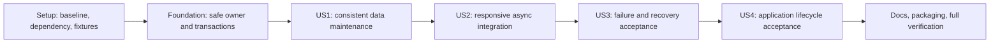

# Tasks: Async SQLite Access

**Input**: Design documents from `specs/015-async-sqlite-access/`

**Prerequisites**: [plan.md](plan.md), [spec.md](spec.md), [research.md](research.md), [data-model.md](data-model.md), [persistence contract](contracts/persistence.md), [external compatibility contract](contracts/external-compatibility.md), [quickstart.md](quickstart.md), and [memory-synthesis.md](memory-synthesis.md).

**Tests**: Included because the specification explicitly requires independently tested acceptance scenarios, failure checks, compatibility checks and measurable workloads; the constitution also requires behavior-focused regression and integration coverage. Add the new assertions first and confirm they fail for the relevant missing behavior, then implement. Keep existing passing coverage rather than duplicating it.

**Organization**: Four user-story phases in specification order: US1, US2 and US3 are P1; US4 is P2. Shared resource/transaction safety belongs in the foundation; each later story has its own independently runnable acceptance checks after its stated prerequisites.

## Format: `[ID] [P?] [Story] Description`

- All tasks start with an unchecked checkbox and sequential ID.
- `[P]` means the task can share its stated execution wave with work in distinct files after its explicit prerequisites pass. It does not override dependencies.
- `[US1]`–`[US4]` label story tasks only; setup, foundation and polish tasks have no story label.
- File paths are relative to the repository root. Proposed production/test paths must be created by their owning tasks; existing paths must be preserved.

## Path Conventions

Python code remains in `src/kllm/`, tests in `tests/`, feature evidence in `specs/015-async-sqlite-access/`, operational/maintainer docs in `docs/`. No native/helper/dashboard redesign, general JSON-state migration, new public SQL routes or unrelated indexes are included. Keep `kllm.agent:app`, supported synchronous facades and injected test patch surfaces.

## Phase 1: Setup (Shared Infrastructure)

**Purpose**: Establish a reproducible baseline and the minimal dependency/file boundaries before storage adoption.

- [X] T001 Record the baseline Git revision, Python/SQLite/platform versions, existing regression results, exact legacy schema/index inspection and old-store fixture expectations in `specs/015-async-sqlite-access/validation.md`; use the existing regression command from `specs/015-async-sqlite-access/quickstart.md`, isolate all data, and retain the revision for the later identical before/after workload without touching live stores.
- [X] T002 Add only `SQLAlchemy>=2.0.54,<2.1` to `pyproject.toml` and resolve it into `uv.lock` with uv; preserve the current Python support, installer flow and dependency groups, and add no async driver, ORM session layer or migration framework (depends on T001).
- [X] T003 [P] Create the minimal package files `src/kllm/persistence/__init__.py`, `src/kllm/persistence/options.py`, `src/kllm/persistence/sqlite.py` and `src/kllm/persistence/operations.py` following the plan's responsibility boundaries without changing existing facade imports (depends on T002).
- [X] T004 [P] Create shared legacy SQLite fixtures in `tests/sqlite_fixtures.py` using the pre-change DDL from T001, fixed observation times/IDs/cursor secret and representative network authority/journal records; support both current and missing-`nodes.context` files and sanitized process fixture seeding (depends on T001; independent of T003).

**Checkpoint**: Dependency reproducible, baseline recorded, legacy fixture formats fixed. T003/T004 may run together after T002; do not infer any runtime feature completion from package skeletons.

---

## Phase 2: Foundational (Blocking Prerequisites)

**Purpose**: Implement the common owner, synchronous units, finite ownership and commit safety required before either domain switches to pooled access.

**Critical**: Complete T005–T013 before story implementation. This safety foundation is part of the US1 MVP, not optional late polish.

- [X] T005 Add failing observable foundation contract tests in `tests/test_sqlite_persistence.py` for options validation, bounded synchronous admission/checkout, one-connection reuse, read/write isolation, explicit BEGIN, same-lease helper nesting, rollback/reset failure, commit/cancel arbitration, partial initialization cleanup, sanitized failures and zero resources after synchronous close; use real temporary files and synchronized barriers.
- [X] T006 [P] Implement immutable `SQLiteOptions` and constructor/environment parsing in `src/kllm/persistence/options.py`, preserving the exact model constraints "`pool_size` (default 1, integer 1–4)", "`wait_timeout` (default 5 seconds, finite positive)", "`shutdown_timeout` (default 10 seconds, finite positive)" and "overflow 0, admitted operation maximum 32"; reject malformed, zero, negative and non-finite settings before an owner is published (depends on T005).
- [X] T007 [P] Implement operation identity, owner/lease generation tracking, cancellation token, finite synchronous admission/waiter accounting and commit arbitration in `src/kllm/persistence/operations.py`; preserve "`WAITING → QUEUED → RUNNING → PRE_COMMIT → COMMITTING → COMMITTED`", "RUNNING → COMPLETED", "ROLLING_BACK → FAILED/CANCELLED" and "OUTCOME_UNKNOWN" with terminal records holding no connection; reuse admission for inline bounded compositions (depends on T005; independent of T006).
- [X] T008 Implement owner construction, canonical path identity, explicit `QueuePool`, lazy connections, connection-local policy hooks and secure per-store initialization fences in `src/kllm/persistence/sqlite.py`; use pool size from options, overflow zero and finite checkout/contention waits, preserve "`NEW → INITIALIZING → OPEN → CLOSING → CLOSED`", and apply store-specific profiles without publishing half-initialized owners (depends on T006/T007).
- [X] T009 Implement synchronous `read`, `write` and scoped maintenance/test leases in `src/kllm/persistence/sqlite.py`; disable sqlite3 implicit BEGIN, issue exactly one deferred read/IMMEDIATE write transaction, pass the same Core connection to helpers, fully consume results, reject unsupported nested public writes and prevent connection/cursor escape (depends on T008).
- [X] T010 Connect operation cancellation/commit arbitration to transaction cleanup in `src/kllm/persistence/sqlite.py` and `src/kllm/persistence/operations.py`; cancellation-first rolls back, commit-first retains ownership to confirmed/unknown outcome, no mutation is retried automatically, and reset failure invalidates the lease; preserve "Acquired → IN_USE → CLEANING → RETURNED" or "CLEANING → INVALIDATED" (depends on T009).
- [X] T011 Implement synchronous close, failed-open cleanup and low-cost created/closed/in-use/waiting counters in `src/kllm/persistence/sqlite.py`; stop admission, drain owned leases, dispose only after drain, and leave an explicit unavailable CLOSING owner when the deadline expires instead of claiming CLOSED (depends on T010).
- [X] T012 Implement centralized sanitized error translation in `src/kllm/persistence/sqlite.py` using the existing `PersistenceError` hierarchy in `src/kllm/exceptions.py`; preserve original sqlite3/OSError and domain validation/conflict errors, categorize timeout/closed/unknown failures, and exclude SQL parameters, JSON bodies, signing material and private paths from messages (depends on T011).
- [X] T013 Run `uv run python -m pytest -q tests/test_sqlite_persistence.py`, verify the T005 behaviors and lock order from `specs/015-async-sqlite-access/contracts/persistence.md`, and record commands/results in `specs/015-async-sqlite-access/validation.md`; fix failures in the owning foundation modules before opening story work (depends on T012).

**Checkpoint**: Default-capacity synchronous storage is safe, bounded and usable; one-lease transactions, honest close outcomes and error contracts pass before domain adoption.

---

## Phase 3: User Story 1 — Maintain stored data consistently (Priority: P1, MVP)

**Goal**: Both existing domains use the same maintainable query-builder/lease conventions without changing saved data, schema constraints or supported synchronous behavior.

**Independent Test**: In temporary usage/network stores, demonstrate CRUD/filter/order/upsert, data-like query strings, unchanged legacy records/cursors/recovery state after reopen and one temporary stored-field/filter change following the same documented workflow. Run with pool sizes one and four; US2 async integration is not required for this check.

### Tests for User Story 1

- [X] T014 [P] [US1] Add failing domain maintenance/legacy-adoption contract cases in `tests/test_sqlite_integration.py` using `tests/sqlite_fixtures.py`: both stores initialize/reopen, preserve IDs/relations/cursor secrets, repeatably adopt missing context, retain harmless extra columns, reject unsupported/corrupt files without reset, and bind parameter-looking values as data (depends on T013).
- [X] T015 [P] [US1] Extend `tests/test_usage.py` for compound history snapshots at pool sizes one/four, exact cursor/page/series parity and existing small physical budgets; keep meaningful corruption and `_write` failure injection checks as scoped-lease adoption changes the storage internals (depends on T013; separate file from T014).
- [X] T016 [P] [US1] Declare all five existing usage Core tables in `src/kllm/usage_schema.py`, preserving these data-model definitions verbatim: `nodes`: "`node_id TEXT PK`, `host TEXT NOT NULL`, `role TEXT NOT NULL`, `context TEXT NOT NULL DEFAULT '{}'`"; "Logical node owner for readings/lifetimes; context stays serialized JSON"; `lifetimes`: "`lifetime_id TEXT PK`, `node_id TEXT NOT NULL`, `pid INTEGER NOT NULL`, `role TEXT NOT NULL`, `started_at TEXT NOT NULL`, nullable `ended_at TEXT`, `state TEXT NOT NULL`, nullable `model TEXT`"; "Identifies a process lifetime; retain running/ended/unobserved transitions and current timestamp rules"; `associations`: "`lifetime_id TEXT NOT NULL`, `model TEXT NOT NULL`, `observed_from TEXT NOT NULL`, nullable `observed_until TEXT`; composite PK `(lifetime_id, observed_from)`"; "Logical model interval within a lifetime; preserve existing interval construction/ending"; `readings`: "`id INTEGER PK`, `lifetime_id TEXT NOT NULL`, `node_id TEXT NOT NULL`, `observed_at TEXT NOT NULL`, `received_at TEXT NOT NULL`, `payload TEXT NOT NULL`"; "Unique `(lifetime_id, observed_at)`; preserve ID/order and JSON validation"; `meta`: "`key TEXT PK`, `value TEXT NOT NULL`"; "Cursor secret, base bytes, last successful save, storage truncation metadata and existing keys"; also preserve "`readings_time(observed_at, id)`" and "`readings_filter(node_id, lifetime_id, observed_at, id)`", current UTC text/JSON serialization, actual SQLite PK nullability and logical relationships without adding foreign keys (depends on T014/T015).
- [X] T017 [P] [US1] Declare all 14 existing network Core tables in `src/kllm/managed_network/schema.py`, preserving these data-model definitions verbatim: `metadata`: "`key TEXT PK`, `value TEXT NOT NULL`"; "Local identity and cluster binding, plus current metadata"; `peers`: "`node_id TEXT PK`, `role TEXT NOT NULL`, `body TEXT NOT NULL`"; "Partial unique `one_master(role)` where role='master'"; `node_directory`: "`node_id TEXT PK`, `body TEXT NOT NULL`"; "Current node network identity"; `authority`: "`binding TEXT PK`, `body TEXT NOT NULL`"; "Current master authority per binding"; `channels`: "`peer TEXT PK`, `binding TEXT NOT NULL`, `term INTEGER NOT NULL`, `session TEXT NOT NULL`, `channel TEXT NOT NULL`"; "Accepted channel fence"; `networks`: "`id TEXT PK`, `binding TEXT NOT NULL`, `state TEXT NOT NULL`, `revision INTEGER NOT NULL`, `body TEXT NOT NULL`"; "Partial unique `one_live_network(binding)` where state!='stopped'"; `assignments`: "`network TEXT FK networks(id)`, `node TEXT`, `address TEXT NOT NULL`, `revision INTEGER NOT NULL`, `body TEXT NOT NULL`; PK `(network,node)`"; "Unique `(network,address)`"; `operations`: "`id TEXT PK`, `network TEXT FK networks(id)`, `binding TEXT NOT NULL`, `request TEXT NOT NULL`, `digest TEXT NOT NULL`, `revision INTEGER NOT NULL`, `body TEXT NOT NULL`"; "Unique `(binding,request)`"; `results`: "`operation TEXT FK operations(id)`, `node TEXT`, `phase_sequence INTEGER`, `body TEXT NOT NULL`; PK `(operation,node,phase_sequence)`"; "Phase result identity"; `journals`: "`id TEXT PK`, `network TEXT FK networks(id)`, `operation TEXT FK operations(id)`, `node TEXT NOT NULL`, `phase TEXT NOT NULL`, `body TEXT NOT NULL`"; "Ownership and restoration intent/observation"; `commands`: "`key TEXT PK`, `digest TEXT NOT NULL`, `state TEXT NOT NULL`, nullable `result TEXT`"; "Idempotent command intent/completion"; `reservations`: "`id TEXT PK`, `network TEXT FK networks(id)`, `state TEXT NOT NULL`, `body TEXT NOT NULL`"; "Partial unique `one_live_run(network)` where state!='released'"; `leases`: "`id TEXT PK`, `network TEXT FK networks(id)`, `node TEXT NOT NULL`, `generation INTEGER NOT NULL`, `state TEXT NOT NULL`, `body TEXT NOT NULL`"; "Partial unique `one_live_lease(network,node)` where state!='released'"; `evidence`: "`network TEXT FK networks(id)`, `node TEXT`, `body TEXT NOT NULL`; PK `(network,node)`"; "Durable verification evidence; no reusable live deadline"; retain actual nullable PK/relationship columns, partial unique predicates, no new cascades, UUID text and existing Pydantic JSON bodies (depends on T014/T015; separate file from T016).
- [X] T018 [P] [US1] Replace permanent connection ownership and routine writes in `src/kllm/usage_store.py` with the shared owner and Core statements; retain DELETE/FULL/FULL-auto-vacuum, secure repeatable existing context upgrade, record validation, lifetime/association transitions, duplicate behavior, atomic ingestion and separately committed physical-budget pruning; preserve "Default retained history is 24 hours with 256 MiB physical storage budget; smaller supported budgets remain valid" (depends on T016/T013).
- [X] T019 [US1] Convert routine reads/filters/counts/ordering/joins in `src/kllm/usage_store_queries.py` to Core expressions accepting one operation-bound connection; pass that lease through coverage/meta/filter helpers, preserve current cursor signing and UTC parsing, and return fully materialized unchanged results without nested checkout (depends on T018).
- [X] T020 [US1] Adapt compound history responses and supported synchronous ownership factories in `src/kllm/agent/handlers/usage.py` and `src/kllm/agent/usage_runtime.py` to gather related response fields on a single snapshot while preserving injection surfaces, window values "`15m`, `1h`, `24h`" and "limit 1–1000, default 500" (depends on T019).
- [X] T021 [P] [US1] Adopt the shared owner/schema initialization in `src/kllm/managed_network/store.py`; preserve secure DB/lock file creation, WAL/FULL and per-connection `foreign_keys=ON`, validate current schema before admitting operations, and keep the existing reentrant execution fence and its five-second deadline (depends on T017/T013; independent of T018–T020).
- [X] T022 [US1] Convert routine network CRUD/query/upsert methods in `src/kllm/managed_network/store.py` to Core units, leaving domain validators and StoreConflict behavior in place; keep the same synchronous public return meanings, revision/idempotency/authority/recovery checks and short transaction boundaries without holding a lease across external mutation (depends on T021).
- [X] T023 [US1] Replace persistent `.db` fixture access with explicit scoped leases in `tests/test_usage.py`, `tests/test_managed_network_critical.py` and `tests/test_node_directory.py`; migrate any additional direct-connection consumers found through CodeGraph/source audit, and preserve fault injection, schema/query-plan assertions and facade patch names (depends on T020/T022; record additional exact paths in `specs/015-async-sqlite-access/validation.md`).
- [X] T024 [US1] Document table declarations, same-lease helpers, domain-specific initialization and the repeatable future-field/filter maintenance workflow in `docs/persistence.md`; add an illustrative temporary-schema field/filter exercise to `tests/test_sqlite_integration.py` without adding product fields or connection handling to business operations (depends on T023).
- [X] T025 [US1] Run US1 new cases plus existing usage/network/directory/control boundary regressions from `specs/015-async-sqlite-access/quickstart.md`, compare legacy fixtures/results, and record SC-001/SC-003 evidence in `specs/015-async-sqlite-access/validation.md` before moving to async integration (depends on T024).

**Checkpoint**: US1 is a demonstrable maintenance MVP on temporary/local stores with safe foundational pooling. It is not completion of the requested async feature; continue through the remaining stories for the full scope.

---

## Phase 4: User Story 2 — Keep the application responsive during storage work (Priority: P1)

**Goal**: Async storage users move blocking work, acquisition and lock waits off the event loop while supported sync/background consumers share the same bounded ownership.

**Independent Test**: Run concurrent sync/async reads/writes against both domains, hold/delay one storage operation, cancel queued/acquiring work, verify later consumers can proceed, and demonstrate the specified unrelated local status latency workload. Requires US1 store adoption; US3/US4 acceptance extensions are not prerequisites.

### Tests for User Story 2

- [X] T026 [P] [US2] Add failing real local HTTP ingest/status and mixed sync/async contract cases to `tests/test_sqlite_integration.py`: no SQL/checkout/init wait on the event loop, preserved ingest acknowledgement/resource fields, finite unavailable result under usage and network-route saturation, delayed cold usage/network startup without event-loop waits, and later access after request cancellation (depends on T025).
- [X] T027 [P] [US2] Add failing dispatcher cases in `tests/test_sqlite_persistence.py` for bounded submission, cancellation before admission/while queued/during checkout, inline composition reentrancy, sync/async transaction isolation, and ownership retained after a caller disappears (depends on T025; independent file from T026).
- [X] T028 [US2] Implement bounded lazy worker dispatch and awaitable admission/queue handling in `src/kllm/persistence/operations.py`; use `max(2, pool_size)` workers, maximum 32 admitted active/queued operations and a bounded waiter list, acquire admission before submission, observe all worker outcomes, and execute nested bounded compositions inline without resubmission (depends on T026/T027).
- [X] T029 [US2] Expose `aread`, `awrite`, tracked async initialization and `aclose` through `src/kllm/persistence/sqlite.py` and `src/kllm/persistence/__init__.py`; share one engine with sync users, include lease acquisition/transaction cleanup inside the worker, and never release resources merely because an await/Future was cancelled (depends on T028).
- [X] T030 [US2] Await a tracked bounded ingestion composition in `src/kllm/agent/handlers/usage.py` and offload cold usage/network owner construction in `src/kllm/agent/usage_runtime.py`, `src/kllm/agent/application_lifecycle.py` and startup facade hooks in `src/kllm/agent/__init__.py` before the US2 gate; keep body/auth/process/resource validation and successful `accepted`, `duplicates`, `last_successful_save` and optional `resources_accepted` semantics unchanged (depends on T029).
- [X] T031 [P] [US2] Move blocking persistence segments off the event loop in `src/kllm/managed_network/bootstrap.py` and `src/kllm/agent/services/network_channel.py`; keep socket/network awaits outside leases and revalidate authority/channel/pairing preconditions after await boundaries where required (depends on T029).
- [X] T032 [P] [US2] Adapt async persistence segments in `src/kllm/agent/services/managed_network.py` and `src/kllm/managed_network/guided_setup.py` to the tracked bridge without changing orchestration/state-machine contracts; keep protected synchronous compositions on one worker and no connection across platform effects (depends on T029; separate files from T031/T033/T034).
- [X] T033 [P] [US2] Integrate tracked ownership around existing prepare/apply offloads and remaining async pre/post persistence in `src/kllm/managed_network/executor.py`; preserve the same-thread shielded intent → OS mutation → observation fence, prevent double submission and do not replace it with per-statement awaits (depends on T029).
- [X] T034 [P] [US2] Audit and adapt blocking runtime/admission storage compositions in `src/kllm/agent/services/rpc_runs.py` and injected persistence consumers in `src/kllm/agent/services/runtime_control.py`; retain current run/runtime lifecycle ownership and source identity contracts, documenting source-confirmed nonblocking paths rather than making needless edits (depends on T029).
- [X] T035 [US2] Audit async storage-backed handlers in `src/kllm/agent/handlers/managed_network.py` and adapt synchronous network/operation views, selections and lookups to awaited tracked bounded compositions; preserve sync service methods, existing authentication/revision checks and payloads, map PersistenceError to sanitized unavailable behavior, audit other async handlers for the same pattern, and prove held-lease contention through real HTTP tests in `tests/test_sqlite_integration.py` before the US2 gate (depends on T030–T034).
- [X] T036 [US2] Map new PersistenceError outcomes alongside existing sqlite3/OSError handling in `src/kllm/agent/handlers/usage.py`, `src/kllm/agent/handlers/membership.py`, `src/kllm/agent/handlers/lifecycle.py`, `src/kllm/agent/application_lifecycle.py` and startup facade hooks in `src/kllm/agent/__init__.py`, `src/kllm/agent/services/usage_collector.py`, `src/kllm/agent/services/usage_overview.py` and `src/kllm/agent/services/membership_maintenance.py`; preserve current 400/404/409/503 behavior and retained-state semantics, including admission/checkout timeouts and cold-start failures, before the US2 acceptance gate (depends on T035/T030).
- [X] T037 [US2] Preserve synchronous collector/live-view consumption and safe state-lock scope in `src/kllm/agent/services/usage_collector.py` and `src/kllm/agent/services/usage_overview.py`; no state lock may enclose a pool wait, SQL or worker join, and sync calls must use the same admission accounting as async calls (depends on T030–T034/T035/T036).
- [X] T038 [US2] Implement the named `responsiveness` acceptance workload in `tests/test_sqlite_integration.py`: 10,000 fixed retained observations, 20 mixed consumers, at least 200 `/health` probes, `/v2/status` during usage delay with network storage available, a barrier-controlled 2-second storage delay, pool sizes one/four and at least 95% unrelated requests within 1 second (depends on T037).
- [X] T039 [US2] Run async/domain boundary suites and the serial responsiveness selection from `specs/015-async-sqlite-access/quickstart.md`; run the identical workload through a pre-change adapter using T001's baseline revision, and record versions, percentiles, errors and SC-002 outcomes in `specs/015-async-sqlite-access/validation.md` without claiming hardware-independent speedup (depends on T038).

**Checkpoint**: Async and synchronous callers share bounded storage without event-loop stalls; actual latency evidence and worker/cancellation ownership checks pass.

---

## Phase 5: User Story 3 — Preserve trusted state during contention and failure (Priority: P1)

**Goal**: Prove and complete failure/cancellation/restart behavior at real domain boundaries while preserving network ownership, history durability and honest acknowledgements.

**Independent Test**: Force pre-commit failures/cancellation and commit races, fail retention after insertion, race two real processes for protected network state, retry identifiers and restart populated files. Verify no partial transaction effects, no false save, unchanged conflict/recovery decisions and explicit sanitized unavailable outcomes.

### Tests for User Story 3

- [X] T040 [P] [US3] Add barrier-based long-statement interruption, rollback/reset-failure, cancellation-first/commit-first and unresolved-commit lease tests in `tests/test_sqlite_persistence.py`; verify stale interrupt requests cannot target a newer lease and no connection is reused before cleanup (depends on T039).
- [X] T041 [P] [US3] Add domain fault and real two-process initialization/mutation/idempotency contract cases in `tests/test_sqlite_integration.py` using `tests/sqlite_fixtures.py`; cover post-ingestion prune failure, queued/pre-commit/committing HTTP cancellation, stale revision/authority, duplicate identifier/digest, corrupted store and restart recovery (depends on T039; separate file from T040).
- [X] T042 [P] [US3] Complete usage retention fault/cancellation boundaries and recorder metadata synchronization in `src/kllm/usage_store.py`: ingestion is one atomic batch, each deletion/truncation metadata unit is atomic, physical checks occur between commits, committed insertion survives later prune failure, duplicate retries stay safe and cached save status cannot falsely acknowledge failure (depends on T040/T041).
- [X] T043 [P] [US3] Complete pooled network guard/recovery behavior in `src/kllm/managed_network/store.py` and `src/kllm/managed_network/recovery.py`, preserving existing revision/phase/ownership/endpoint validators, terminal journal tombstones and "Receive-relative monotonic admission/evidence deadlines are zeroed before persistence and invalid after restart"; verify protected fences remain effective across processes (depends on T040/T041; separate files from T042).
- [X] T044 [US3] Implement operation-scoped sqlite progress/deadline checks and guarded interruption in `src/kllm/persistence/sqlite.py` and `src/kllm/persistence/operations.py`; verify operation/lease generation before interruption, prohibit interrupt after COMMITTING, clear handlers before reuse and retain unresolved leases for confirmed cleanup (depends on T040; integrate with T042/T043 after their edits).
- [X] T045 [US3] Complete sanitized confirmed/OUTCOME_UNKNOWN reconciliation at domain composition boundaries in `src/kllm/agent/handlers/usage.py`, `src/kllm/managed_network/executor.py` and `src/kllm/persistence/operations.py`; preserve caller cancellation and shielded required observations, use existing reading/command IDs to inspect durable outcomes, and never add automatic mutation retries or success fields (depends on T044).
- [X] T046 [US3] Audit remaining Core exception/cancellation boundaries in `src/kllm/agent/__init__.py`, `src/kllm/agent/application_lifecycle.py`, `src/kllm/agent/services/managed_network.py` and `src/kllm/agent/services/network_channel.py`; keep facade patch surfaces and existing signed-control/HTTP result formats, and propagate actionable storage unavailability instead of empty healthy state (depends on T045/T036).
- [X] T047 [US3] Verify/repair externally observable failure/privacy parity in `tests/test_control_api_v2.py`, `tests/test_dashboard_api.py`, `tests/test_network_channel.py`, `tests/test_network_pairing_recovery.py` and `tests/test_usage.py`; assert validation/auth/lookup/conflict/unavailable formats and absence of SQL parameters, payload contents and credentials from responses/logs (depends on T046).
- [X] T048 [US3] Run fault/process/legacy tests plus existing managed-network, usage, pairing, RPC and runtime recovery regressions and record SC-003/SC-005/SC-006 evidence in `specs/015-async-sqlite-access/validation.md`; report unavailable process/platform coverage explicitly and fix domain failures before lifecycle completion (depends on T047).

**Checkpoint**: All confirmed saves survive restart; interrupted units have no partial state, uncertain outcomes remain explicit, and cross-process authority/idempotency/recovery behavior passes.

---

## Phase 6: User Story 4 — Reuse and release bounded local resources (Priority: P2)

**Goal**: Complete application-level quiescence, failed-start cleanup and directory replacement with bounded resource use and verified drain-before-dispose behavior.

**Independent Test**: Run 1,000 mixed operations and 100 open/close cycles at capacities one/four, race startup/close/directory changes with live sources, and force abnormal close failure followed by release/drain. Every successful close leaves zero owned connections/jobs/waiters/workers; failed close stays unavailable and blocks replacement.

### Tests for User Story 4

- [X] T049 [P] [US4] Add resource/lifecycle contract tests in `tests/test_sqlite_persistence.py` for max owned connections, demonstrable reuse, source-job ownership, mixed sync/async close, rejected late admission and deadline expiration retaining CLOSING rather than false CLOSED (depends on T048).
- [X] T050 [P] [US4] Add real application lifespan, partial-start failure, live-feed/collector shutdown race and canonical-path/directory replacement tests in `tests/test_sqlite_integration.py`; use separate barriers to block producer quiescence, protected reconciliation and SQL drain past the same total deadline, assert failure within that budget and replacement refusal, then settle tracked work and verify zero resources (depends on T048; separate file from T049).
- [X] T051 [US4] Complete canonical owner-generation/registry isolation in `src/kllm/persistence/sqlite.py`; never pool across forked processes/unrelated owner lifetimes, permit no replacement while old generation can mutate its path, and hold registry locks only for short state transitions (depends on T049/T050).
- [X] T052 [US4] Complete async worker/source-job drain and close deadline enforcement in `src/kllm/persistence/operations.py` and `src/kllm/persistence/sqlite.py`; accept the coordinator's unchanged absolute monotonic deadline and remaining budget without resetting it; cancel queued/waiting jobs once, retain active ownership until cleanup, close workers before final disposal, and report close failure with quarantined work tracked until settlement (depends on T051).
- [X] T053 [P] [US4] Track active live-source jobs and implement stop-scheduling plus await/drain in `src/kllm/agent/live.py` and `src/kllm/agent/services/dashboard_live.py`; bound every source-job await/drain by the shared lifecycle deadline and retain unsettled work on expiry; eliminate `shutdown(wait=False)` as cleanup evidence while preserving live-feed behavior and sanitized failure reporting (depends on T052).
- [X] T054 [P] [US4] Quiesce collection and network/runtime orchestration in `src/kllm/agent/services/usage_collector.py` and `src/kllm/agent/services/managed_network.py`; protected reconciliation uses the shared lifecycle deadline, retains already admitted continuation access on expiry and remains tracked until settled, and fixed timed joins cannot be reported as completed producer cleanup (depends on T052; independent files from T053).
- [X] T055 [US4] Coordinate stop/failed-start cleanup and reuse the tracked startup integration from T030 in `src/kllm/agent/application_lifecycle.py` and the owning facade hooks in `src/kllm/agent/__init__.py` by creating one absolute monotonic deadline at lifecycle entry (minimum shutdown timeout of affected owners, default 10 seconds), passing it unchanged through quiesce producers → reconcile protected work → close admission → drain → close workers/connections; on expiry in any phase report failure within the total budget, mark owners CLOSING/unavailable, reject external admission and preserve tracked protected continuation without forced fence release; use tracked async close and do not publish a half-owner or falsely healthy failure state (depends on T053/T054).
- [X] T056 [US4] Drain old storage ownership before publishing a replacement in `src/kllm/agent/usage_runtime.py` and managed-network owner lifecycle hooks in `src/kllm/agent/__init__.py`; start the shared lifecycle deadline before replacement quiescence and pass it through old-owner close without resetting; preserve data-directory isolation, refuse replacement after failed close and verify settings snapshot/restart semantics (depends on T055).
- [X] T057 [US4] Implement the named `resource_cycles` acceptance workload in `tests/test_sqlite_integration.py` for 1,000 mixed operations and 100 open/close lifecycles with both stores and capacities one/four; assert actual connection reuse, max counts and final zero connections/leases/jobs/waiters/workers without counting disposal as proof (depends on T056).
- [X] T058 [US4] Run resource-cycle, failed-start/path-change and existing application/live-feed lifecycle checks using `specs/015-async-sqlite-access/quickstart.md`; record SC-004 and FR-007/FR-013 evidence in `specs/015-async-sqlite-access/validation.md`, including explicit abnormal-close failure/recovery results (depends on T057).

**Checkpoint**: Normal lifecycle/directory changes close cleanly, abnormal cleanup never reports success, and pooling remains within its resource bound across repeated lifespans.

---

## Phase 7: Polish & Cross-Cutting Concerns

**Purpose**: Deliver the approved scope with synchronized docs, supported packaging and clearly bounded verification evidence.

- [X] T059 [P] Document the new environment defaults, validation and owner-restart behavior in existing storage/configuration guidance in `docs/agent-install.md`, retaining the supported uv/bootstrap/rebuild commands (depends on T058).
- [X] T060 [P] Document acquisition/contention/closed/unknown-outcome/failed-close diagnosis and retained-data recovery in `docs/troubleshooting.md`, with sanitized errors and no destructive reset advice (depends on T058; independent file from T059/T061).
- [X] T061 [P] Update storage-error/acknowledgement explanations in `docs/control-api-v2.md` against the preserved endpoint contracts, including already committed ingestion after retention failure; introduce no new payload fields, routes or authentication changes (depends on T058).
- [X] T062 Complete `docs/persistence.md` with supported sync/async compositions, lock order, transaction/commit arbitration, per-store policies, future additive upgrades and lifecycle cleanup; reconcile command/test names in `specs/015-async-sqlite-access/quickstart.md` with implemented interfaces (depends on T059–T061).
- [X] T063 Recheck `pyproject.toml`/`uv.lock` coherence, run `uv sync`, `uv run python scripts/build.py` and package/SQLAlchemy/native imports from `specs/015-async-sqlite-access/quickstart.md`, and record actual build/import results in `specs/015-async-sqlite-access/validation.md`; do not substitute dependency installation alone for verification (depends on T062).
- [X] T064 Run the complete targeted regression set and wider `uv run python -m pytest -q` suite, plus relevant Python lint checks for modified modules/tests, and record fresh captured commands/results or pre-existing failures in `specs/015-async-sqlite-access/validation.md`; only add Rust/dashboard checks if those surfaces actually changed (depends on T063).
- [X] T065 Run the real-file, initialization-race, two-process fence, cancellation, lifecycle and directory checks on available supported macOS/Linux/Windows and Python versions; record the exact missing platform/scenario follow-ups in `specs/015-async-sqlite-access/validation.md` rather than claiming unavailable coverage (depends on T064).
- [X] T066 Reconcile all FR-001–FR-015 and SC-001–SC-006 against actual code/test/workload evidence in `specs/015-async-sqlite-access/validation.md`; fix unmet outcomes in their owning tasks, preserve original thresholds, and distinguish controlled SQLite/HTTP/process evidence from physical cluster/GPU or unmeasured performance claims (depends on T065).
- [X] T067 Review the final affected-source/doc diff for leftover permanent connections, escaped cursors, event-loop blocking, unbounded queues/waits, incorrect catch sites, duplicate models and unrelated changes; update `specs/015-async-sqlite-access/tasks.md` and feature-local `specs/015-async-sqlite-access/memory.md` to reflect only verified completion, without writing durable project memory or implicitly committing/pushing (depends on T066).

---

## Dependencies & Execution Order

### Phase Dependencies

Setup T001–T004 → foundation T005–T013 → US1 T014–T025 → US2 T026–T039 → US3 T040–T048 → US4 T049–T058 → polish T059–T067.

### User Story Dependencies

- US1 needs only setup/foundation. It is the suggested maintenance MVP and is independently demonstrable on temporary stores.
- US2 needs US1's adopted stores/query contracts; it can be accepted before the later failure/lifecycle extensions.
- US3 needs the US2 async bridge for cancellation/commit HTTP/process acceptance, while ordinary atomicity/conflict safety is already mandatory in foundation/US1.
- US4 needs completed async/domain outcome tracking to prove full application quiescence and replacement safely; basic synchronous resource cleanup already exists in foundation.
- These stories share the same stores/owner and cannot truthfully be declared fully independent implementation branches. Their acceptance scenarios are independently runnable after stated prerequisites; use the explicit dependency order.

### Within Each User Story

Write the stated failing behavior checks first; declare schema/model constraints before consumers; migrate domain operations before boundaries; integrate before recording acceptance. Same-file edits are sequential. A `[P]` marker permits only the named wave after all its prerequisites, never concurrent edits to the same file or dependent interface.

### Parallel Opportunities

- Setup: T003/T004 after T002.
- Foundation: T006/T007 after T005.
- US1: T014/T015, then T016/T017; after schemas, usage adoption T018 and network initialization T021 can proceed independently. Keep T021/T022 and T018/T019/T020 internally sequential.
- US2: T026/T027, then after T029 (and T030 in a strictly ordered pass) independent service/executor changes T031/T032/T033/T034.
- US3: T040/T041; after those tests, T042/T043 use different domain files. Serialize shared persistence/outcome/boundary edits T044–T047.
- US4: T049/T050, then T053/T054 after T052.
- Polish: T059/T060/T061 after all story gates. T062 touches separate docs but starts after that wave for coherence review.

## Parallel Example: User Story 1

After foundation T013, author `tests/test_sqlite_integration.py` cases in T014 alongside `tests/test_usage.py` cases in T015. After both test contracts, implement `src/kllm/usage_schema.py` (T016) alongside `src/kllm/managed_network/schema.py` (T017). Once declarations exist, T018 usage adoption and T021 network initialization can run together; no two workers edit a single store module.

## Parallel Example: User Story 2

After US1, T026 HTTP/mixed-consumer tests and T027 dispatcher tests use separate files. After the bridge/API in T028/T029, T031 bootstrap/channel, T032 network service/guided setup, T033 executor and T034 RPC/runtime consumers may proceed together while preserving their existing synchronous interfaces. T037 integration and T038 workload follow all four.

## Parallel Example: User Story 3

After US2, T040 low-level cancellation tests and T041 process/domain tests use separate files. T042 usage retention and T043 network guards/recovery can follow together. Merge before T044 interruption and T045 shared outcome work; never overlap shared operation-module edits.

## Parallel Example: User Story 4

After US3, T049 pool lifecycle tests and T050 application lifespan tests use separate files. After T051/T052 owner/worker closure, T053 live-feed and T054 collector/network quiescence can run together; lifecycle ordering T055 waits for both.

## Implementation Strategy

### MVP First (User Story 1)

Complete setup/foundation and US1 through T025. Demonstrate common maintenance conventions and legacy-data compatibility on isolated stores. Validate the checkpoint before async migration; this is a maintenance increment, not completion or automatic deployment of the full feature.

### Incremental Delivery

Complete US2 responsiveness, US3 domain failure/recovery and US4 full lifecycle/resource acceptance in order, preserving earlier passing contracts. Continue through all four stories and final checks to deliver the requested feature. Do not stop at MVP unless the user narrows scope.

### Parallel Execution Strategy

Use only the explicit disjoint-file waves once prerequisites are complete. `[P]` describes scheduling opportunities; it does not itself authorize spawning agents in a session that lacks delegation instructions. Shared persistence, lifecycle and domain-store migrations stay sequential at their owning boundaries.

## Requirement Coverage

| Requirements / outcomes | Primary task coverage |
|---|---|
| FR-001/FR-002, SC-001: common query maintenance | T002, T016–T025, T062 |
| FR-003, SC-002: async/sync responsiveness | T026–T039 |
| FR-004/FR-005, SC-004: bounded reuse/waits | T005–T013, T027–T029, T049–T058 |
| FR-006/FR-015, SC-005: atomicity/cancellation/outcomes | T009/T010, T040–T045 |
| FR-007/FR-013: cleanup/isolation | T008/T011, T049–T058 |
| FR-008/FR-009, SC-003: old-data/history compatibility | T004, T014–T025, T041/T042/T048 |
| FR-010, SC-006: authority/ownership/idempotency/recovery | T017/T021/T022, T031–T034, T041/T043/T045/T048 |
| FR-011/FR-012: external failures and bound values | T012, T014, T026/T030, T035/T036, T046/T047/T061 |
| FR-014: maintenance/operational docs | T024, T059–T062 |
| All outcomes and packaging/portability gates | T063–T067 |

## Notes

All 67 tasks are initially incomplete. Completion checkboxes represent implemented and verified work, not documentation existence or mocked approximations. New schema definitions quote current field constraints verbatim; preserve legacy nullability/keys rather than silently strengthening schema through Core defaults. Test names proposed by quickstart must actually exist before those commands are reported as passing. Keep evidence feature-local and isolated from secrets/live stores. No before_tasks or after_tasks hooks are currently registered; recheck hook configuration before completing task generation.
